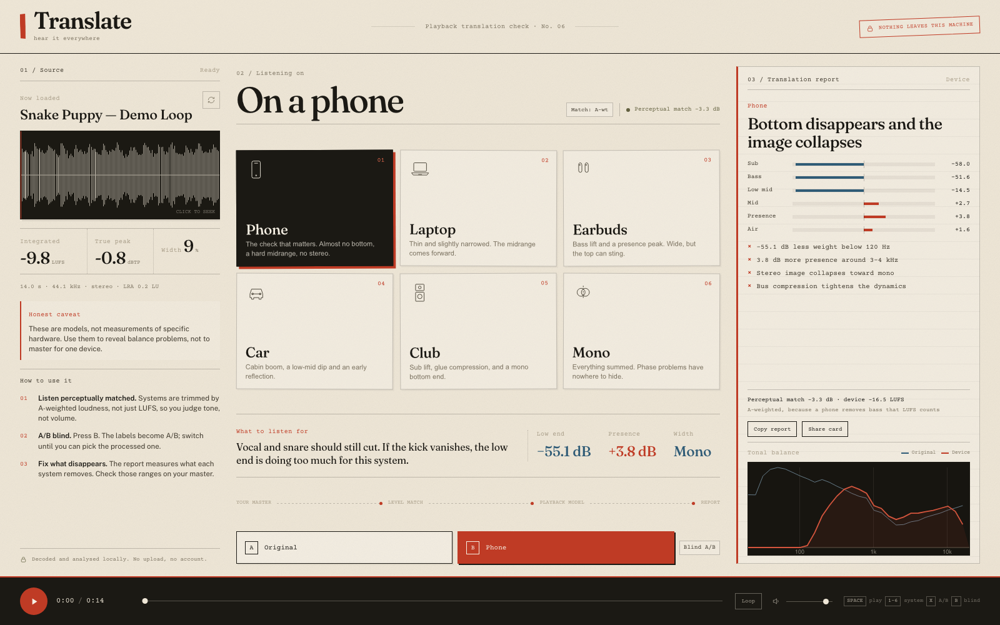
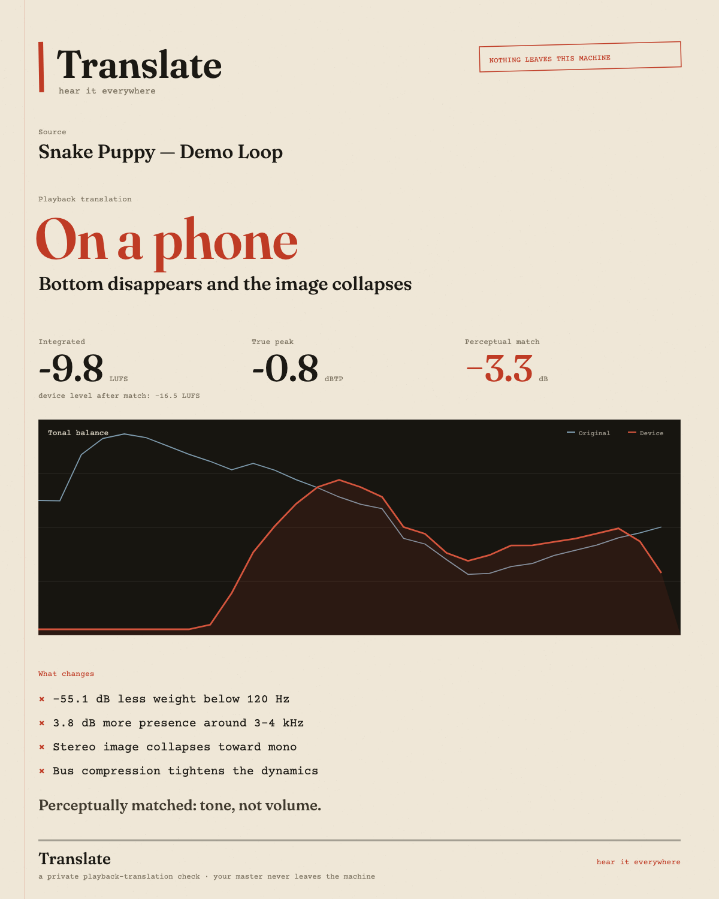

# Translate

**Hear your master everywhere — in the browser, without uploading it.**

Translate is a local playback-translation checker for music producers and mastering
engineers. Drop a track, press play, and switch between six playback-system models:
phone, laptop, earbuds, car, club and mono. Every model is perceptually
level-matched to your master, so you are judging tone and balance, not volume. An A/B blind mode hides
which side is the original, and the report measures what each system removes.

Nothing is uploaded. Decoding, loudness analysis, rendering and playback all happen
in the browser tab.



The share card it can export:



## Why it exists

Most translation tools are plug-ins, which means installing, authorising and
remembering to put them on the master bus. This is a link. It runs on any machine
with a modern browser, it never sees the audio, and it answers the one question
that matters before a release: *does this hold up outside my room?*

## Run it locally

The app is a static site — no build step, no server code.

```bash
cd translate
python3 -m http.server 4173
open http://127.0.0.1:4173
```

Use `assets/demo.wav` if you just want to hear the demo loop (a 14-second
generated electronic sketch, not a commercial recording).

## What you get

| Control | What it does |
|---|---|
| **Drop a master** | WAV, AIFF, MP3, FLAC; whatever the browser decodes. Files stay in memory. |
| **Six systems** | Phone, laptop, earbuds, car, club, mono. Click a card or press 1–6. |
| **Match** | A-weighted perceptual match by default; click to switch to integrated LUFS or raw level. |
| **A/B** | A is the original, B is the system. `X` toggles. |
| **Blind** | `B` randomises A/B and hides the labels. `Reveal` shows the truth. |
| **Report** | Matched band deltas (sub → air), stereo-width change and plain-language notes. |
| **Copy report** | Copies a text summary to the clipboard. |
| **Share card** | Downloads a 1200 × 1500 PNG with the track, system, metrics, spectrum and notes. |

## What is measured

- **Integrated loudness** — ITU-R BS.1770-4 K-weighting, 400 ms blocks, absolute and relative gating.
- **Loudness range** — 3 s short-term windows, 10th/95th percentiles.
- **True peak** — 4× Catmull-Rom oversampled estimate (not a full ITU true-peak meter).
- **Stereo width** — side/mid energy ratio, plus correlation.
- **Tonal balance** — averaged FFT, log-spaced bands from 20 Hz to 20 kHz.
- **Perceptual match** — A-weighted level from the third-octave spectrum. A phone removes the bass that LUFS counts, so a pure LUFS match leaves its remaining midrange much louder. The `Match` button cycles A-weighted, LUFS and off.
- **Model deltas** — each model is rendered offline through the same chain you hear, then compared band-by-band after applying its match trim.
- **Headroom** — a model match is peak-clamped so it cannot push the master past −1 dBFS, and the output has a fixed 3 dB safety trim before the final limiter.

## Why the default match is A-weighted

A phone speaker is mostly a midrange device. Integrated LUFS is dominated by the
low end, so matching a phone model purely by LUFS removes its bass, then boosts the
remaining mids to compensate — and it sounds much louder than the original even
though the numbers match. A-weighting follows the ear's sensitivity, so the phone
and laptop are trimmed down and the fuller models stay close. The match button lets
you compare the three behaviours: `A-wt`, `LUFS`, and `Off`.

## The models

They are deliberately simple and audible: a mid/side width stage, a handful of
filters, optional soft saturation, compression and a short early reflection. They are
**not** measurements of specific hardware and they are **not** codec simulations. Use
them to expose balance problems; do not master to a model.

The report and the copy call this out. If you want calibrated hardware models or
codec previews, those are separate, much larger projects.

## Deploy it / share it

The folder is already a complete static site. Pick any host:

- **Netlify Drop** — drag the `translate` folder onto https://app.netlify.com/drop
- **Cloudflare Pages** — upload the folder as a direct-upload project
- **GitHub Pages** — push the folder to a repo and enable Pages
- **Any web server** — copy the folder; `index.html` is the entry point

No environment variables, no backend, no database. HTTPS is recommended so the
clipboard button works everywhere.

## Files

```
index.html          layout
css/app.css         the entire visual system
js/app.js           UI, waveform, spectrum, share card
js/engine.js        audio graph, model rendering, routing, level match
js/devices.js       the six playback models
js/dsp.js           BS.1770 loudness, peaks, stereo, FFT
assets/demo.wav     generated demo loop
assets/*.ttf        Fraunces, Public Sans, Courier Prime (SIL OFL)
docs/app.png        this screenshot
docs/share-card.png example report card
```

## Licence

Code: MIT (see `LICENSE`). Typefaces: SIL Open Font License 1.1
(`assets/OFL-Fraunces.txt`, `assets/OFL-PublicSans.txt`, `assets/OFL-CourierPrime.txt`). The demo audio is generated for this project and is free to use.

The name and branding are yours to change before publishing.
